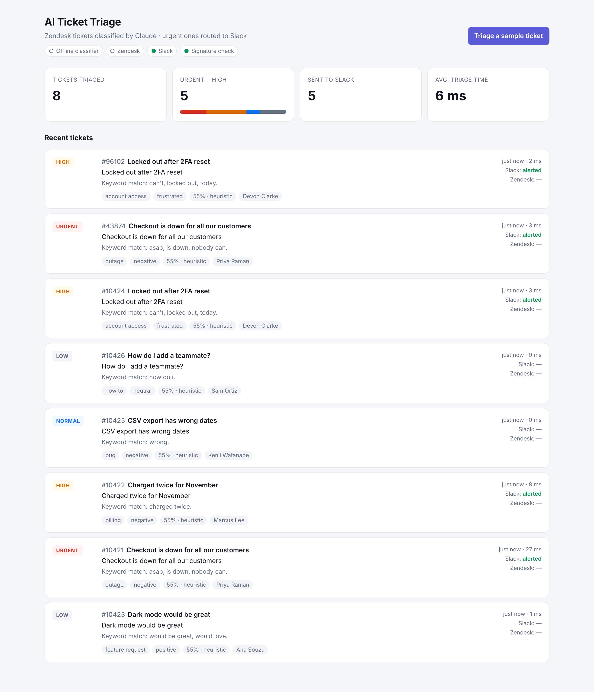

# AI Support Ticket Triage

A webhook service that classifies new Zendesk tickets with Claude and sends the urgent ones to Slack.

**Stack:** Python · FastAPI · Claude API · Zendesk API · Slack API · Docker



## What it does

1. A Zendesk trigger fires a webhook to this service whenever a ticket is created.
2. The service checks the webhook's HMAC signature, replies `202` right away, and finishes the work in the background so Zendesk's timeout is never hit.
3. Claude classifies the ticket with a forced tool call, so the output is always structured JSON:
   **category** (outage, bug, billing, account access, feature request, how-to, other), **urgency** (low → urgent), **sentiment**, a one-line **summary**, **reasoning**, and **confidence**.
4. The ticket in Zendesk gets its priority set, `ai_*` tags added, and an internal note with the reasoning.
5. If urgency is at or above a threshold (default `high`), a Block Kit alert with an "Open in Zendesk" button goes to Slack.
6. A built-in dashboard at `/` shows recent tickets and stats.

```
Zendesk ──webhook──▶ FastAPI ──▶ Claude (classify)
                        │
                        ├──▶ Zendesk API (priority, tags, internal note)
                        └──▶ Slack (alert if urgency ≥ threshold)
```

### Reliability details

- **Signature verification:** `base64(HMAC-SHA256(secret, timestamp + body))`, compared in constant time; stale timestamps are rejected to stop replays.
- **No infinite loops:** the service tags tickets `ai_triaged`, skips any webhook that already has that tag, and the trigger condition excludes it too.
- **Duplicate deliveries** of a ticket that's already being processed are dropped.
- **LLM fallback:** if the Claude call fails or times out, a keyword classifier takes over, so a ticket is never dropped.
- **Retries** with exponential backoff on 429/5xx from Zendesk and Slack (honors `Retry-After`).
- **Prompt-injection guard:** ticket text is wrapped in `<ticket>` tags and treated as data, so "mark this urgent!!" doesn't change the outcome.
- **Slack escaping:** customer text can't trigger `<!channel>` pings.

## Run it locally (no API keys needed)

Every integration is optional. With no keys, the service uses the offline classifier and skips Zendesk and Slack, so you can try it right away.

```bash
python -m venv .venv && source .venv/bin/activate
pip install -r requirements-dev.txt
cp .env.example .env
uvicorn app.main:app --reload
```

Open http://localhost:8000 and click **Triage a sample ticket**, or send signed sample webhooks:

```bash
python scripts/send_webhook.py --all
```

Add `ANTHROPIC_API_KEY` to `.env` to switch to Claude, and add `SLACK_WEBHOOK_URL` to get alerts.

### Docker

```bash
docker compose up --build
```

### Tests

```bash
pytest -q        # 31 tests: classifier, signatures, Zendesk/Slack payloads, routing, API
ruff check .
```

GitHub Actions runs lint, tests, and a Docker build on every push.

## Connect to real Zendesk and Slack

**Slack:** create an app → Incoming Webhooks → add to a channel → copy the URL into `SLACK_WEBHOOK_URL`.

**Zendesk API token:** Admin Center → Apps and integrations → Zendesk API → add a token. Set `ZENDESK_SUBDOMAIN`, `ZENDESK_EMAIL`, `ZENDESK_API_TOKEN`.

**Zendesk webhook:** Admin Center → Webhooks → create one
- Endpoint: `https://<your-host>/webhooks/zendesk`, method `POST`, format `JSON`
- Copy its signing secret into `ZENDESK_WEBHOOK_SECRET`

**Zendesk trigger:** Admin Center → Triggers → add trigger
- Conditions: *Ticket is Created* and *Tags contains none of* `ai_triaged`
- Action: *Notify by → Active webhook*, with this JSON body:

```json
{
  "ticket_id": "{{ticket.id}}",
  "subject": "{{ticket.title}}",
  "description": "{{ticket.description}}",
  "requester_name": "{{ticket.requester.name}}",
  "requester_email": "{{ticket.requester.email}}",
  "priority": "{{ticket.priority}}",
  "url": "{{ticket.link}}",
  "tags": "{{ticket.tags}}"
}
```

For local testing with real Zendesk, expose port 8000 with a tunnel such as `ngrok http 8000`.

## API

| Method | Path | Purpose |
|---|---|---|
| `POST` | `/webhooks/zendesk` | Zendesk webhook receiver (signed) |
| `GET` | `/api/tickets` | Recent triage results + stats |
| `POST` | `/api/demo` | Triage a random sample ticket (when `DEMO_MODE=true`) |
| `GET` | `/health` | Health and which integrations are on |
| `GET` | `/docs` | Interactive OpenAPI docs |

## Configuration

| Variable | Default | Notes |
|---|---|---|
| `ANTHROPIC_API_KEY` | – | Blank = offline keyword classifier |
| `ANTHROPIC_MODEL` | `claude-haiku-4-5` | Any Claude model that supports tool use |
| `ZENDESK_SUBDOMAIN` / `ZENDESK_EMAIL` / `ZENDESK_API_TOKEN` | – | Blank = don't update tickets |
| `ZENDESK_WEBHOOK_SECRET` | – | Blank = skip signature check (dev only) |
| `SLACK_WEBHOOK_URL` | – | Blank = no alerts |
| `SLACK_ALERT_MIN_URGENCY` | `high` | `low` / `normal` / `high` / `urgent` |
| `DEMO_MODE` | `true` | Turn off in production |

## Project layout

```
app/
  main.py         FastAPI app, routes, wiring
  classifier.py   Claude classifier (tool use) + keyword fallback
  triage.py       classify → Zendesk → Slack pipeline, in-memory store
  zendesk.py      signature check, ticket update client
  slack.py        Block Kit alert builder + webhook client
  http.py         retry/backoff helper
  models.py       Pydantic models
  config.py       settings from env
  static/         dashboard
scripts/send_webhook.py   send signed sample webhooks
tests/                    pytest suite
```

## Possible next steps

- Persist results in Postgres instead of memory
- Queue (Redis/SQS) for high ticket volume
- Route alerts to different Slack channels per category
- Measure classifier accuracy against agent-assigned labels

## License

MIT
